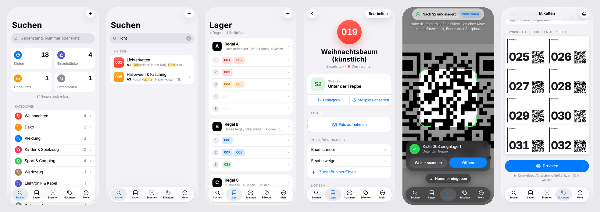

# Fundort – Ordnung im Keller

**Kisten und große Teile nummerieren, Inhalt erfassen, alles sofort wiederfinden.**
Eine schlichte Web-App im Apple-Stil, die sich wie eine native iPhone-App installieren lässt – plus ein einfaches System, mit dem aus unbeschrifteten Kisten ein Keller wird, in dem man alles findet.



---

## Die Idee

Im Keller stehen viele unbeschriftete Kisten mit Deko, Kleidung, Werkzeug & Co., dazwischen große Teile ohne Kiste. Mit Filzstift zu beschriften hält nicht lange: Der Inhalt ändert sich, die Schrift passt nicht mehr, und gesucht wird trotzdem Kiste für Kiste.

Fundort macht es wie ein Versandlager („chaotische Lagerhaltung“):

| | Was | Warum |
|---|---|---|
| 🗄️ | **Jeder Regalboden hat eine Adresse** (A1, A2 … B3 …) – jedes Regal mit so vielen Böden, wie es hat | Man weiß sofort, wo etwas steht |
| 📍 | **Plätze außerhalb der Regale heißen S1, S2 …** – z. B. „Unter der Treppe“, „Wandhaken“, „Garage“ | Auch Großes und Abseitiges hat einen festen Ort |
| 🏷️ | **Alles bekommt eine feste Nummer** (001, 002 …) mit QR-Code – Kisten genauso wie Einzelstücke (Weihnachtsbaum, Koffer, Kinderwagen) | Die Nummer bleibt für immer, egal was drin ist oder wo es steht |
| 📱 | **Die App merkt sich den Rest**: Foto, Stichworte, Platz | Gesucht wird am Handy, nicht im Regal |

„Wo ist die Lichterkette?“ → in der App „licht“ eintippen → **Kiste 002, Regal A, Boden 1**.

## Das System in vier Regeln

1. **Jeder Boden hat eine Adresse.** Regale bekommen Buchstaben (A, B, C … links neben der Tür beginnend, einmal rundherum), ihre Böden werden **von oben nach unten** gezählt – jedes Regal so weit, wie es Böden hat. „B3“ = Regal B, dritter Boden von oben.
2. **Was nicht ins Regal passt, bekommt einen Stellplatz.** S1, S2 … mit einem Namen wie „Unter der Treppe“. Das gilt auch für Orte außerhalb des Kellers (Garage, Dachboden).
3. **Alles bekommt eine Nummer.** Kisten und große Einzelstücke teilen sich eine fortlaufende Nummer. Aufs Etikett kommen nur Nummer, Kategorie-Farbe und QR-Code – kein Inhalt. Deshalb muss nie neu beschriftet werden.
4. **Die App merkt sich den Rest.** Etwas raus oder rein? Nummer scannen, Platz scannen – fertig.

Die ausführliche Anleitung mit Checkliste für den Einräum-Tag, Material-Liste und Gewohnheiten steht im **[Keller-Handbuch](docs/SYSTEM.md)** (zum Ausdrucken und an die Kellertür hängen) und direkt in der App unter *Mehr → Das Fundort-System*.

## Was die App kann

- **Suchen** – Volltextsuche über Titel, Inhalt, Notizen, Kategorie, Nummer und Platz (auch Stellplatz-Namen wie „Treppe“). Findet Wortteile („licht“ → „Lichterkette“, „Kürbis-Lichter“) und markiert die Treffer.
- **Lager** – alle Regale mit ihren Böden (unterschiedlich hohe Regale werden genau so dargestellt) und alle Stellplätze, jeweils mit farbigen Nummern-Chips. Eigene Seiten pro Regal, Boden und Stellplatz.
- **Kisten und Einzelstücke** – Nummer, Titel, Kategorie, Platz, Fotos, Inhalt bzw. Zubehör und Notizen. Einzelstücke sind runde, Kisten eckige Nummern-Symbole.
- **Scannen** – Kamera-Scanner in der App:
  - Nummern-Etikett scannen → Kiste bzw. Einzelstück wird angezeigt
  - danach Boden- oder Stellplatz-Etikett scannen → dort eingelagert (mit „Widerrufen“)
  - unbekannte Nummer scannen → direkt als Kiste oder Einzelstück erfassen
- **Etiketten** – druckfertige A4-Bögen mit QR-Codes:
  - Nummern-Etiketten vorab (passen für Kisten und Einzelstücke) oder für Erfasstes
  - Boden-Etiketten (A1, A2 …), große Regal-Schilder und Stellplatz-Etiketten (S1, S2 …)
  - Formate **105 × 74 mm (8 pro Bogen)** und **70 × 37 mm (24 pro Bogen, auch als Anhänger)**, mit Schnittlinien für normales Papier; angebrochene Etikettenbögen lassen sich weiterverwenden
- **Lagerorte** – Regale hinzufügen und entfernen, Böden pro Regal einzeln einstellen, Stellplätze anlegen (mit Vorschlägen wie „Unter der Treppe“, „Garage“).
- **Umlagern** – per Raster (Regal × Boden, kürzere Regale mit Lücken) plus Stellplätze, per Scan oder vom Platz aus („Hierher stellen“). Zusätzlich „Ohne festen Platz“ und „Nicht im Keller“ (entnommen).
- **Kategorien mit Farben** – z. B. Weihnachten = rot, Kleidung = blau. Die Farbe erscheint auf dem Etikett und in der App.
- **Backup** – Export/Import als Datei (inkl. Fotos), z. B. in iCloud Drive.
- **Offline-fähig**, Hell-/Dunkelmodus, keine Anmeldung, keine Cloud – alle Daten bleiben auf dem Gerät.

## Auf dem iPhone installieren

Die App ist eine Progressive Web App (PWA): Sie läuft im Browser, lässt sich aber wie eine echte App auf den Home-Bildschirm legen – ohne App Store und ohne Xcode.

**1. Online stellen (einmalig)** – z. B. kostenlos mit GitHub Pages:
1. Im Repository *Settings → Pages* öffnen.
2. Bei *Source* „Deploy from a branch“ wählen, den Branch mit der App und den Ordner `/ (root)` auswählen, speichern.
3. Nach ein bis zwei Minuten ist die App unter `https://<benutzername>.github.io/Orga/` erreichbar.

> GitHub Pages für private Repositories braucht einen kostenpflichtigen GitHub-Plan. Alternativ funktioniert jeder statische Hoster (z. B. Netlify, Cloudflare Pages) – einfach den Ordner hochladen. Wichtig ist **HTTPS**, sonst funktioniert die Kamera nicht.

**2. Auf dem iPhone:** Adresse in **Safari** öffnen → Teilen-Symbol → **„Zum Home-Bildschirm“**. Beim ersten Scannen den Kamerazugriff erlauben.

**3. Loslegen:** Beim ersten Start legst du fest, wie viele Regale es gibt, wie viele Böden jedes einzelne hat und welche Stellplätze es außerhalb der Regale gibt. Mit „Erst mit Beispieldaten ausprobieren“ kannst du alles gefahrlos testen und danach unter *Mehr → Alle Daten löschen* neu beginnen.

## Gut zu wissen

- **Daten liegen nur auf dem Gerät.** Es gibt (noch) keine Synchronisierung. Für mehrere Personen: auf einem Gerät pflegen und das Backup teilen, oder ein „Keller-Handy“ bestimmen. Regelmäßig *Mehr → Backup erstellen* – die App erinnert daran, wenn das letzte Backup älter als 30 Tage ist.
- **Mit der App scannen, nicht mit der Kamera-App.** Auf dem iPhone haben die installierte App und Safari getrennte Speicher. Scannt man ein Etikett mit der normalen Kamera, öffnet sich Safari ohne deine Daten. Die QR-Codes funktionieren trotzdem dauerhaft, auch wenn die App einmal umzieht – der Scanner liest nur Nummer, Boden bzw. Stellplatz aus.
- **Drucken:** Im Druckdialog „Tatsächliche Größe“ / 100 % wählen und Seitenränder/Skalierung ausschalten. Am bequemsten druckt man vom Computer oder aus Safari.
- **Etiketten haltbar machen:** auf normales Papier drucken und mit breitem Klebeband oder Klebefolie überkleben, in selbstklebende Etikettentaschen stecken oder direkt auf Etikettenbögen drucken. Für Einzelstücke eignen sich kleine Etiketten als Anhänger (lochen, mit Kabelbinder befestigen).
- **Ältere Daten** aus der ersten Version werden automatisch übernommen: Alles Bestehende gilt als Kiste, Stellplätze kommen einfach dazu.

## Entwicklung

Kein Build-Schritt, keine Abhängigkeiten zur Laufzeit außer zwei mitgelieferten Bibliotheken.

```bash
python3 -m http.server 8000
# → http://localhost:8000  (Kamera funktioniert auf localhost auch ohne HTTPS)
```

```
index.html            App-Hülle
manifest.webmanifest  PWA-Manifest (Name, Icons, Standalone-Modus)
sw.js                 Service Worker (offline, Cache)
css/app.css           Gesamtes Design inkl. Dark Mode und Etiketten-Druck
js/main.js            Router, Tab-Bar, Navigation
js/store.js           Datenmodell, IndexedDB, Suche, Backup, Beispieldaten
js/format.js          Formatierung: Nummern, Plätze, Kisten/Einzelstücke
js/ui.js              HTML-Templates, Icons, Sheets, Dialoge, Toasts
js/components.js      Wiederverwendbare Bausteine (Badges, Zeilen, Platz-Raster …)
js/qr.js              QR-Codes erzeugen und Etiketten-Inhalte lesen
js/scan-worker.js     QR-Erkennung im Hintergrund-Thread
js/views/*.js         Seiten: Suchen, Lager, Kiste, Scannen, Etiketten, Mehr, System, Willkommen
vendor/               qrcode-generator (MIT), jsQR (Apache 2.0)
docs/                 Keller-Handbuch und Vorschaubild
```

**Datenmodell kurz:** Regale `{ id: 'A', note, levels }`, Stellplätze `{ id: 'S1', name }`, Einträge `{ kind: 'box' | 'item', number, title, category, location, items, notes, photos }`. Ein Platz ist `{ shelf, level }`, `{ zone }`, `{ away: true }` oder `null` (ohne festen Platz).

Nach Änderungen an Dateien die Konstante `VERSION` in `sw.js` erhöhen, damit installierte Apps sicher die neue Version laden. `?nosw` an die URL anhängen schaltet den Service Worker beim Entwickeln ab.

## Ideen für später

- Synchronisierung zwischen mehreren Geräten (z. B. über einen kleinen Server oder als native App mit iCloud/CloudKit)
- Mehrere Bereiche mit eigenen Regalen (Keller, Dachboden, Garage) statt nur Stellplätzen
- „Ausgeliehen an …“ und Erinnerungen („Weihnachtskisten nach vorne holen“ im November)
- NFC-Sticker als Alternative zum QR-Code
- Native SwiftUI-Version mit gleichem Datenmodell
